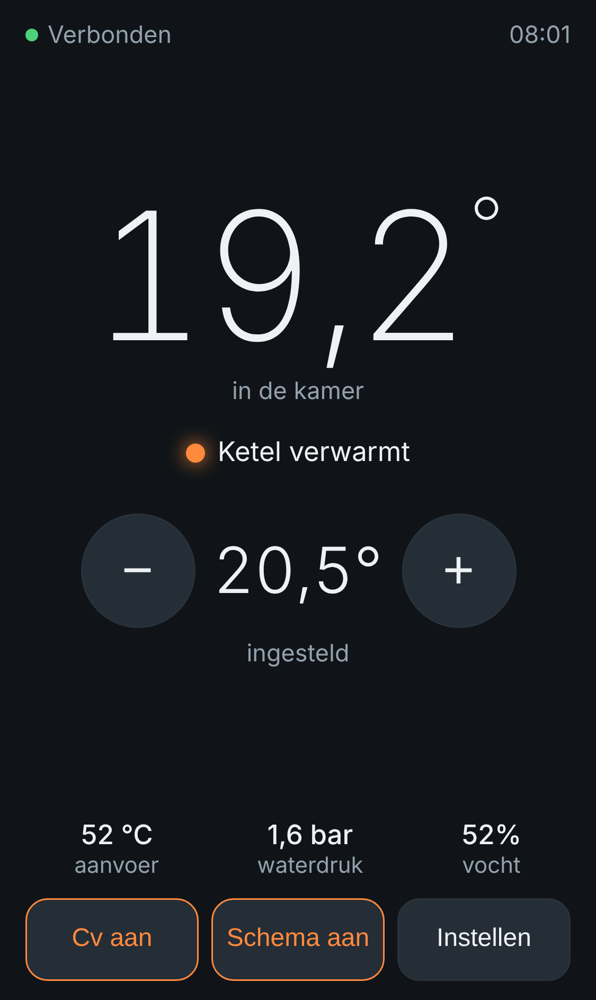

# Thermostaat

Een zelfgebouwde slimme thermostaat voor een cv-ketel met OpenTherm. Een ESP32 met een OpenTherm-adapter regelt de ketel. Een oude telefoon aan de muur (hier een iPhone 12 mini) toont de bedieningspagina.



De regeling draait op de ESP32. Valt de telefoon of de wifi uit, dan blijft de verwarming werken. Home Assistant is niet nodig. Heb je het wel, dan verschijnt de thermostaat daar vanzelf.

## Wat het doet

- Meet de kamertemperatuur en berekent met een PID-regelaar welke aanvoertemperatuur de ketel moet leveren. De ketel brandt dan langer op een lager vermogen in plaats van steeds aan en uit te gaan.
- Weekschema met een comfort- en een ecotemperatuur, met eigen tijden voor het weekend. Zet je de temperatuur met de hand, dan blijft die staan tot het volgende schakelmoment.
- Laat aanvoertemperatuur, waterdruk en luchtvochtigheid zien, en waarschuwt bij lage waterdruk of een storing van de ketel.
- Noodstand: geeft de kamersensor 5 minuten geen waarde, dan vraagt de ESP32 een vaste aanvoertemperatuur van 35 °C, zodat het huis niet afkoelt.
- Warm tapwater blijft altijd aan.
- Het scherm is zwart zolang er niemand is. Een bewegingssensor bij de telefoon zet het aan zodra iemand langsloopt, en 30 seconden nadat de sensor niets meer ziet, wordt het weer zwart. Op een OLED-scherm staan zwarte pixels uit, dus het scherm brandt niet in en verbruikt bijna niets. Zonder bewegingssensor gaat het scherm aan als je het aanraakt.

## Wat je nodig hebt

| Onderdeel | Voorbeeld | Prijs (niet nagekeken) |
|---|---|---|
| ESP32-bordje | ESP32 DevKit (esp32dev) | ongeveer € 8 |
| OpenTherm-adapter | adapter van Ihor Melnyk, of de Master OpenTherm Shield van DIYLESS | € 25 tot € 35 |
| Temperatuursensor | SHT40 op een los bordje (I2C) | een paar euro |
| Bewegingssensor | HC-SR501 (PIR) | een paar euro |
| Verbindingsklemmen | 2 stuks met 3 openingen, bijvoorbeeld Wago 221-413 | een paar euro |
| Voeding | USB-lader van 5 V met kabel | n.v.t. |
| Kastje en draadjes | | een paar euro |

## Aansluiten

De bouwinstructie met tekeningen per stap staat in `bouwinstructie.html`.

1. Zoek in de handleiding van je ketel op welke twee klemmen voor OpenTherm zijn. Zit je oude thermostaat al op die klemmen, dan gebruik je dezelfde twee draden. Zit hij op aparte aan-uitklemmen, dan sluit je de adapter op de OpenTherm-klemmen aan.
2. Haal de stekker van de ketel uit het stopcontact. Je werkt alleen aan de twee dunne thermostaatdraden. Aan de 230 V in de ketel kom je niet.
3. Sluit de twee thermostaatdraden aan op de OpenTherm-kant van de adapter. Bij OpenTherm maakt de volgorde van de twee draden niet uit.
4. De adapter en de SHT40 hebben allebei 3,3 V en GND nodig, en de ESP32 heeft maar één 3V3-pin. Verbind de 3V3-pin en een GND-pin daarom elk met een verbindingsklem.
5. Verbind de adapter met de ESP32: IN naar GPIO16 (RX2), OUT naar GPIO17 (TX2), VCC naar de 3V3-klem en GND naar de GND-klem. Vraagt je adapter 5 V, gebruik dan VIN.
6. Verbind de SHT40: SDA naar GPIO21, SCL naar GPIO22, VCC naar de 3V3-klem, GND naar de GND-klem.
7. Verbind de bewegingssensor: OUT naar GPIO27, GND naar de GND-pin aan de andere kant van het bordje. VCC gaat naar VIN, dat 5 V geeft als de ESP32 via USB gevoed wordt. Het signaal op OUT is 3,3 V en dus veilig voor de ESP32. Richt de sensor op de plek waar mensen langslopen.
8. Hang de temperatuursensor waar je oude thermostaat hing, op ongeveer 1,5 meter en onder het kastje. De ESP32 wordt een beetje warm en die warmte stijgt op.

Andere pinnen? Pas ze bovenaan `thermostaat.yaml` aan, onder `substitutions`.

Geen stopcontact bij de plek van de oude thermostaat? Dan zet je de ESP32 en de adapter bij de ketel en gebruik je in de woonkamer een draadloze temperatuursensor. Dat vraagt een kleine aanpassing in `thermostaat.yaml`.

## Op de ESP32 zetten

```
pip install esphome
cp secrets.example.yaml secrets.yaml      # vul je wifi en wachtwoorden in
openssl rand -base64 32                    # plak de uitkomst bij api_sleutel
esphome run thermostaat.yaml              # de eerste keer via USB
```

Latere updates gaan via wifi met dezelfde opdracht.

Vindt de ESP32 je wifi niet, dan maakt hij een eigen netwerk met de naam `Thermostaat-instellen`. Maak daar verbinding mee en vul je wifi opnieuw in.

## De telefoon instellen

1. Open in Safari `http://thermostaat.local`. Werkt dat niet, gebruik dan het IP-adres van de ESP32 (dat staat in je router).
2. Kies Deel en dan Zet op beginscherm. De pagina opent dan zonder adresbalk.
3. Zet bij Instellingen, Beeldscherm en helderheid, Automatisch vergrendelen op Nooit.
4. Zet Begeleide toegang aan (Instellingen, Toegankelijkheid). Drie keer op de zijknop drukken houdt de telefoon dan op deze pagina.
5. Laat de telefoon aan de lader. Zet Geoptimaliseerd opladen aan (Instellingen, Batterij). Een telefoon die jarenlang aan de lader hangt, kan een opgezwollen batterij krijgen. Hang hem daarom niet in een dicht kastje en kijk af en toe of het scherm nog vlak ligt.

## Bekijken zonder hardware

```
python3 proefserver.py
```

Open `http://localhost:8080`, of op de telefoon `http://<ip-van-je-laptop>:8080`. De proefserver doet de ESP32 na en stuurt niets naar een ketel.

## Bijstellen

- **Huis wordt te langzaam warm, of bij vorst niet warm genoeg:** verhoog `aanvoer_max` van 60 naar 70.
- **Temperatuur schiet steeds voorbij de ingestelde waarde:** verlaag `kp` (bijvoorbeeld naar 0,2).
- **Temperatuur blijft steeds iets onder de ingestelde waarde:** verhoog `ki` (bijvoorbeeld naar 0,001).

De waarden voor `kp` en `ki` zijn beginwaarden. Elk huis reageert anders, dus reken op een paar dagen bijstellen.

## Als het misgaat

Bewaar je oude thermostaat. Werkt de nieuwe niet, dan zet je de twee draden terug en werkt alles weer zoals eerst.

Valt de ESP32 helemaal uit, dan krijgt de ketel geen warmtevraag meer en koelt het huis af. De noodstand helpt alleen als de ESP32 nog draait en alleen de sensor uitvalt.

## Wat getest is

- `esphome config thermostaat.yaml` (ESPHome 2026.11.0) keurt de configuratie goed.
- De bedieningspagina werkt met de proefserver in een nagebootste iPhone 12 mini, staand en liggend.
- Niet getest: compileren voor de ESP32 en de werking op een echte ketel. Controleer bij de eerste keer in het logboek (`esphome logs thermostaat.yaml`) of de ketel antwoordt en of de aanvoertemperatuur klopt.
